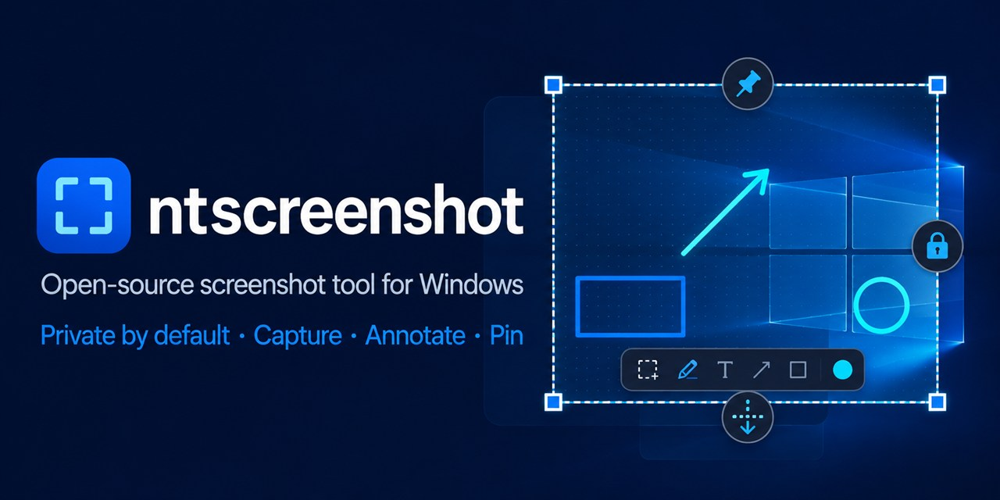
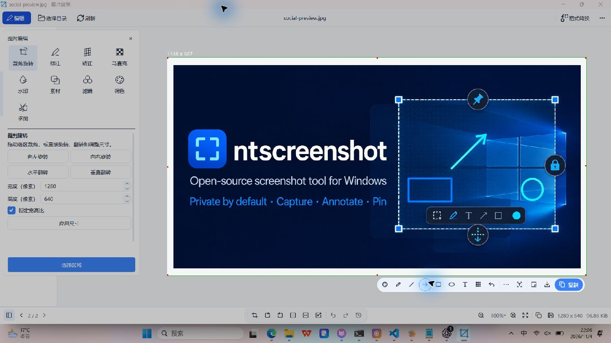
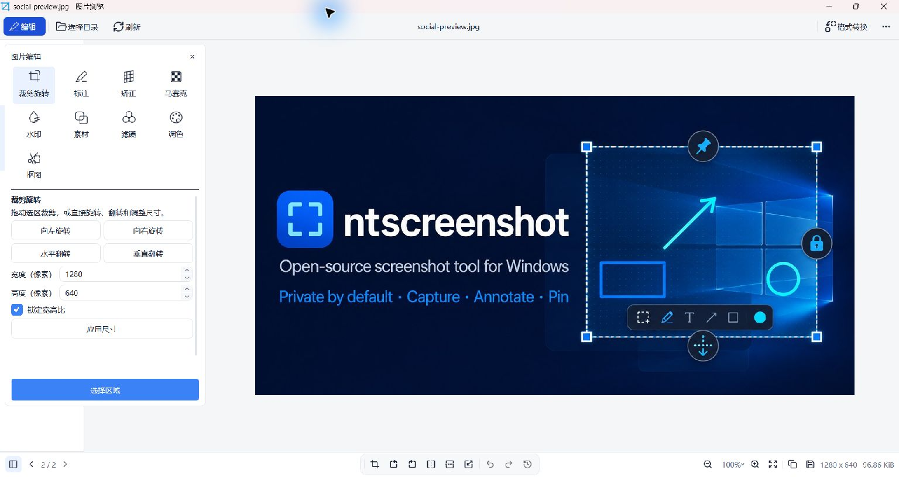
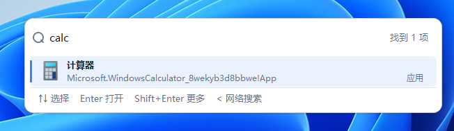
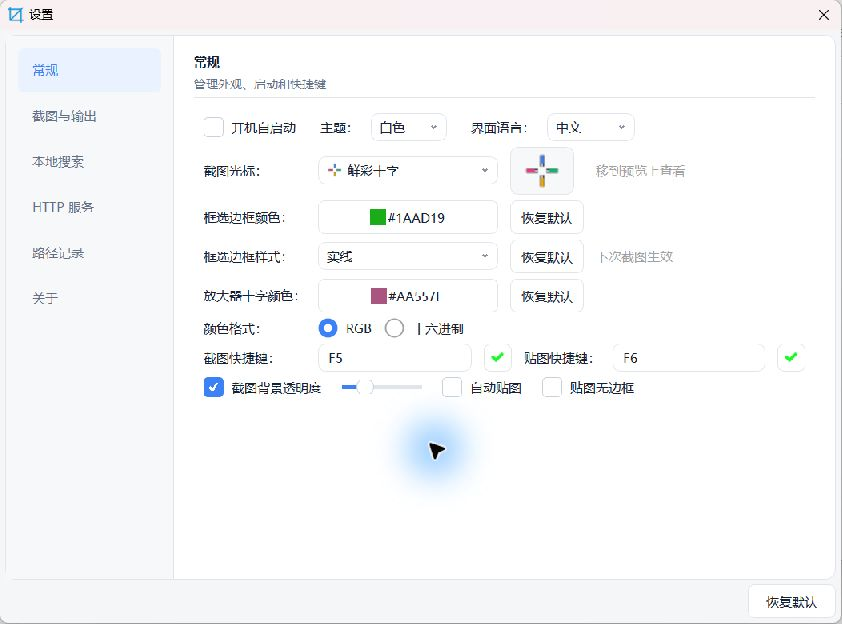

# ntscreenshot

[简体中文](README.zh-CN.md)

**An open-source, privacy-first screenshot and pinning tool for Windows.** Capture, annotate, pin, scroll, and record GIFs in one workflow. Clipboard history and local search stay on your machine; OCR and clipboard AI form filling are opt-in.

**[Download the Windows installer](https://github.com/tujiaw/ntscreenshot/releases/latest)** · [Portable ZIP](https://github.com/tujiaw/ntscreenshot/releases/latest/download/ntscreenshot-x64-Release.zip) · [Quick start](#30-second-start) · [FAQ](#faq) · [Build from source](docs/building.en.md)

Install `ntscreenshot-VERSION-x64-Setup.exe` for the current user without administrator privileges. The default location is `%LocalAppData%\Programs\ntscreenshot`; Start menu shortcuts are included and the desktop shortcut is optional. Upgrading and uninstalling preserve settings and favorites.

Alternatively, extract `ntscreenshot-x64-Release.zip` and run `ntscreenshot.exe` without installation. If a release has no assets yet, follow the [build guide](docs/building.en.md).

## 30-second start

1. Launch the app, find it in the tray, and confirm hotkeys in Settings.
2. `F5` to capture: drag a region, annotate from the toolbar, then copy, save, or pin.
3. `F6` to pin a clipboard image; `Ctrl+Alt+I` to open the image browser.
4. Enable OCR only if needed, using your own service credentials.

| Hotkey | Action |
| --- | --- |
| `F5` | Screenshot |
| `F6` | Pin |
| `Alt+Space` | Local search (default; tries `Ctrl+Alt+Space` if occupied) |
| `Ctrl+Alt+I` | Image browser |
| `Ctrl+Alt+S` | Settings |

Change hotkeys if they clash with a game or another app.

Capture, pin, and search hotkeys are configurable. Image browser and Settings shortcuts are fixed and require successful registration.

## Features

### Capture and annotate

Press `F5` to select a region. Window snapping, pixel-level tweaks, a magnifier, and a color picker (`C` copies the color) stay in the overlay.

- Pen, line, arrow, rectangle, ellipse, text, mosaic, undo
- Copy, save, or pin; scrolling capture and GIF recording
- QR / barcode recognition; optional OCR

### Image browser and editor

Browse thumbnails, zoom and pan, or drop an image / folder to open it. Click **Edit** for nine tool groups: crop / rotate, annotations, perspective correction, mosaic, watermarks, stickers, filters, color adjustment, and background removal. Undo, redo, copy, and Save As keep the workflow in one window.

Convert to PNG, JPEG, BMP, WebP or ICO when their Qt plugins are available, or export a single-page PDF. Save transparent cutouts as PNG. Play or pause GIFs and edit the current frame. See the [image browser guide](docs/image-browser.en.md) for controls, export options, and limits.

### Local search

One box for local apps, files, folders, and browser bookmarks. Arrow keys select, Enter opens.

### Pinning and productivity

- `F6` pins a clipboard image on the desktop, with multi-pin and border options
- Local clipboard history and favorites; optional clipboard AI form filling
- Optional cross-device favorites sync with GitHub sign-in and a shared hosted service. No server or storage setup is needed by users. [Service guide](cloud/clipboard-sync/README.md)

### Settings

Open Settings from the tray. Startup, light / dark theme, capture / pin hotkeys, overlay opacity, and color format live here. The interface defaults to English; choose English or Chinese under General Settings → Display language, then restart the app.

### AI chat and text selection

AI chat, the embedded browser, and text selection have moved to [auto-browser](https://github.com/tujiaw/auto-browser). This app no longer bundles a browser engine. See the [migration guide](docs/ai-migration.md) for configuration and chat history imports.

## Platforms

| Platform | Status |
| --- | --- |
| Windows 10 / 11 x64 | Supported |
| Linux | Not available |
| macOS | Not available |

## FAQ

- Antivirus flags, dead hotkeys, no window after launch: [FAQ](docs/faq.en.md)
- OCR / AI / where data lives: [FAQ](docs/faq.en.md) · [Privacy](PRIVACY.en.md)

Capture, pinning, clipboard history, and local search run offline by default. Text or images leave the machine only when you enable and invoke a network feature. Favorites sync is off by default; ordinary clipboard history is not uploaded. Cloud favorites currently do not use end-to-end encryption. See [Privacy](PRIVACY.en.md).

## Docs

- [FAQ](docs/faq.en.md)
- [Build from source](docs/building.en.md)
- [Docs index](docs/README.md)
- [Changelog](CHANGELOG.md)

## Contributing

Bug reports, documentation fixes, and pull requests are welcome. Read [Contributing](CONTRIBUTING.md) and the [Code of Conduct](CODE_OF_CONDUCT.md). Report security issues privately as described in [Security](SECURITY.md).

[Apache License 2.0](LICENSE). Copyright: [NOTICE](NOTICE). Third-party notices: [THIRD_PARTY_NOTICES.md](THIRD_PARTY_NOTICES.md).

If ntscreenshot helps you, a **Star** is the simplest way to support the project.
