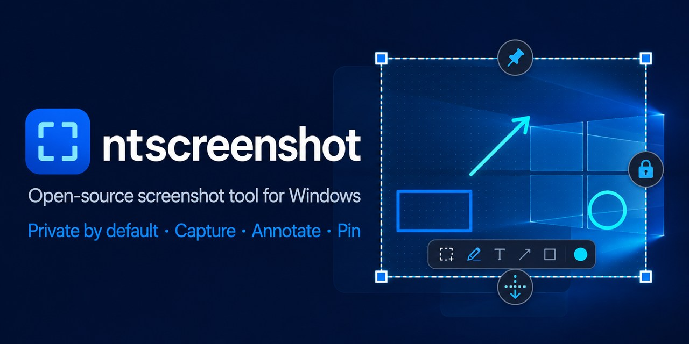
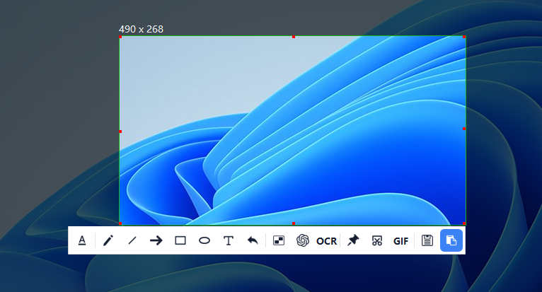
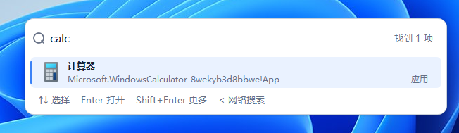
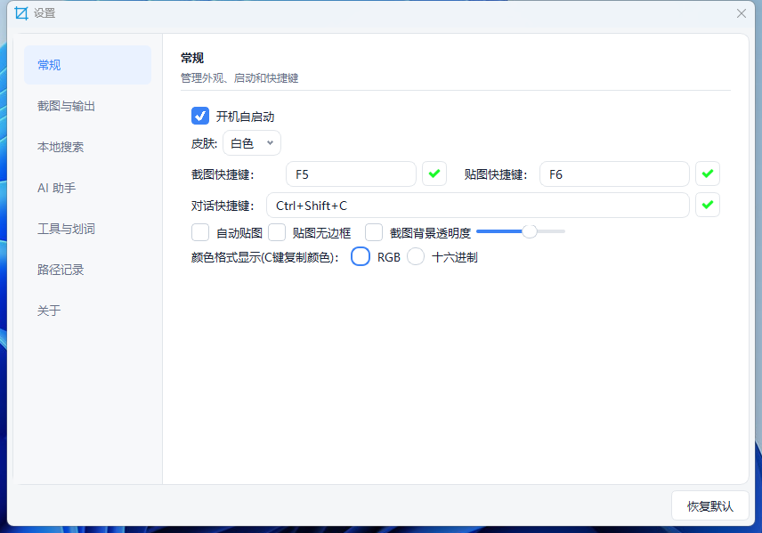

# ntscreenshot

[English](README.md)

**Windows 上开源、离线优先的截图与贴图工具。** 选区、标注、贴图、长图和 GIF 录制一步到位；剪贴板历史与本地搜索都在本机完成。OCR 与剪贴板 AI 表单填充可按需开启。

**[立即下载 Windows 绿色版](https://github.com/tujiaw/ntscreenshot/releases/latest/download/ntscreenshot-x64-Release.zip)** · [查看更新](https://github.com/tujiaw/ntscreenshot/releases/latest) · [常见问题](#faq) · [从源码构建](docs/building.md)

解压 `ntscreenshot-x64-Release.zip`，运行 `ntscreenshot.exe`。无需安装。若 Releases 还没有附件，按 [构建指南](docs/building.md) 自行编译。

## 功能

### 截图与标注

按 `F5` 框选屏幕。窗口吸附、像素级微调、放大镜和取色（`C` 复制颜色）都在选区里完成。

- 画笔、直线、箭头、矩形、椭圆、文字、马赛克、撤销
- 复制、保存、贴图；滚动长截图、GIF 录制
- 识别二维码 / 条码；可选 OCR

### 图片浏览与编辑

格式转换支持使用 Qt 导出单页 PDF，无需新增库。设置随目标格式切换：输出尺寸与锁定比例、彩色／灰度、JPEG/WebP 质量、PNG 无损压缩程度，以及 PDF 图片尺寸／A4 页面、自动／纵向／横向和页边距。PDF 导出会保留原图和撤销记录。

托盘选择“图片浏览”，默认打开配置中的截图保存目录。小图按实际尺寸显示，大图自动适应留白区域；底部显示像素尺寸、文件大小、序号和缩放比例。支持选择或拖入目录、拖入图片定位、缩略图浏览、缩放和平移，以及裁剪、旋转、翻转、调整尺寸、撤销和重做。所有操作也可从右键菜单进入，F11 切换全屏、Esc 退出。`Ctrl+S` 默认另存为 PNG/JPEG，原图覆盖需单独确认；格式转换支持 PNG、JPEG、BMP，以及插件可用时的 WebP 和 ICO。ICO 提供 16／24／32／48／64／128／256 像素图标尺寸，等比缩放居中并补透明边，输出单尺寸图标。

托盘“图片浏览”使用固定全局快捷键 `Ctrl+Alt+I`，“设置”使用 `Ctrl+Alt+S`，注册成功后在菜单右侧显示。

点击左上角“编辑”打开左侧浮动面板，上方为九个工具按钮，下方直接显示所选工具的编辑详情，无需弹窗配置。提供裁剪旋转、标注、矫正、马赛克、水印、素材、滤镜、调色和抠图。标注选择矩形、椭圆或箭头后直接在图片上拖动，松开即完成；文字输入后点击图片放置，绘制过程中按 Esc 可取消。水印支持四角、居中、平铺和自定义选区，透明度、字号、颜色和边距可调；素材可导入本地图片。裁剪、马赛克、素材及自定义水印点击“选择区域”后在图片上拖动选区，按 Enter 或面板内“应用选区”确认，按 Esc 或“取消选区”取消；切换工具会取消未提交的选区。面板保持展开，图片自动避开面板区域；小窗口下详情区可滚动。矫正通过输入原图四角坐标完成透视变换；滤镜提供黑白、复古、反色，以及 OpenCV 高斯模糊、中值降噪、锐化、边缘检测、自动二值化和自动对比度，调色支持亮度、对比度、饱和度、色温、色调和不透明度，提供渐变滑块、数值输入与一键重置。抠图采用 GrabCut：框选主体并在选区外保留背景，应用后背景变透明；支持细化次数与边缘羽化，保留原图尺寸和主体已有透明度，建议另存 PNG。分析图最长边限制为 1280 像素；复杂发丝和透明物体可能需要重新选区。编辑结果支持撤销、重做、复制和保存，使用现有 Qt/OpenCV，不需要新增依赖。

Windows 下可从右上角“更多”菜单将当前图片设为桌面背景或锁屏背景，包含未保存的编辑结果。背景使用独立保存的图片副本，透明区域填充为白色，原图移动或删除不影响该副本；设置失败时显示系统错误。

GIF 可播放和暂停，通过“编辑当前帧”另存静态图片。动画 WebP 取决于已安装的 Qt 图片插件；不支持时会提示。仅浏览当前目录，超过 7200 万像素的图片使用受限预览。

### 本地搜索

一个输入框搜本机应用、文件、目录和浏览器书签。键盘操作：方向键选择，Enter 打开。

### 贴图与效率

- `F6` 把剪贴板图片钉在桌面上，支持多图和边框
- 本机剪贴板历史

### 设置

托盘打开设置。开机自启动、浅色 / 深色主题、截图 / 贴图快捷键、透明度、取色格式都在这里改。界面默认英文，可在“常规设置 → 界面语言”中选择英文或中文，重启应用后生效。

### AI 对话与划词 / AI chat and text selection

这两项功能已迁移至独立项目 [auto-browser](https://github.com/tujiaw/auto-browser)。截图包不再包含浏览器内核；配置与聊天记录的导入方式见 [迁移说明](docs/ai-migration.md)。

## 30 秒上手

1. 启动后看系统托盘，先打开设置确认快捷键。
2. `F5` 截图：拖选区，用底部工具栏标注，再复制、保存或贴图。
3. `F6` 贴图。
4. OCR 只在需要时到设置里打开，用你自己的服务配置。

| 快捷键 | 作用 |
| --- | --- |
| `F5` | 截图 |
| `F6` | 贴图 |

快捷键可改。与游戏或其它软件冲突时换一组即可。

## 为什么用它

系统自带截图只能快拷，做不了贴图、长图和本机搜索。商业工具功能全，但往往不开源、要订阅或会上传。ntscreenshot 把这些高频能力放进一个开源托盘应用，数据默认留在你的电脑上。

## 平台

| 平台 | 状态 |
| --- | --- |
| Windows 10 / 11 x64 | 支持 |
| Linux | 暂未提供 |
| macOS | 暂未提供 |

## 常见问题

- 杀毒软件报警、F5 没反应、启动后没有窗口：[FAQ](docs/faq.md)
- OCR / AI / 数据存在哪：[FAQ](docs/faq.md) · [隐私说明](PRIVACY.md)

截图、贴图、剪贴板和本地搜索默认离线。只有你主动配置并调用联网功能时，内容才会发往你指定的服务。详见 [隐私说明](PRIVACY.md)。

## 文档

- [常见问题](docs/faq.md)
- [从源码构建](docs/building.md)
- [文档目录](docs/README.md)
- [更新日志](CHANGELOG.md)

## 参与

欢迎缺陷报告、文档改进和 Pull Request。请先阅读 [贡献指南](CONTRIBUTING.md) 与 [行为准则](CODE_OF_CONDUCT.md)。安全问题按 [安全策略](SECURITY.md) 私下告知。

[Apache License 2.0](LICENSE)。版权见 [NOTICE](NOTICE)，第三方组件见 [THIRD_PARTY_NOTICES.md](THIRD_PARTY_NOTICES.md)。

如果 ntscreenshot 对你有帮助，欢迎点右上角 **Star**。
