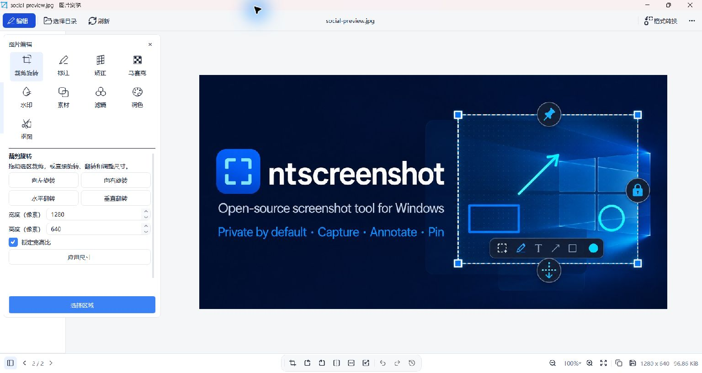

# Image browser and editor

[简体中文](image-browser.md)

## Format conversion

Format conversion includes single-page PDF export using Qt, without extra libraries. Settings change with the selected format: output dimensions with aspect-ratio locking, color/grayscale, JPEG/WebP quality, PNG lossless compression, and PDF image-sized/A4 pages with automatic/portrait/landscape orientation and margins. All format conversions export a separate copy, retaining the source image, unsaved state, and undo/redo history. Export dimensions and color settings do not alter the current edit. Save As switches to the new file and establishes a new editing baseline.

## Browse and save

Open **Image Browser** from the tray to browse the configured screenshot directory. Small images open at actual size; larger images fit with margins. The status bar shows pixel dimensions, file size, position, and zoom. Choose or drop a directory, drop an image to locate it, and browse with thumbnails, zoom, and pan. Crop, rotate, flip, resize, undo, and redo are available, with all actions also accessible from the context menu. F11 toggles full screen and Esc exits it. `Ctrl+S` saves a new PNG/JPEG; overwriting the source requires explicit confirmation. Format conversion supports PNG, JPEG, BMP, WebP, and ICO when their Qt plugins are installed. ICO offers 16/24/32/48/64/128/256 px sizes, preserving aspect ratio and centering with transparent padding in a single-size icon.

The tray provides fixed global shortcuts: `Ctrl+Alt+I` for the image browser and `Ctrl+Alt+S` for settings, displayed beside each menu item when registered.

## Editing tools

Crop offers Free, Original, 1:1, 4:3, 3:2, 16:9 and 9:16 ratios. Drag any corner or edge to resize, or drag inside to move the selection; thirds guides assist composition. Fixed ratios stay constrained at image boundaries. Changing ratios fits inside the current selection around its center. Region selection for other tools stays unconstrained. Enter applies and Esc cancels.

Click **Edit** at the top left to open a floating panel. A compact three-column tool navigation stays at the top, with the selected tool's settings in a stable-height inspector below: crop/rotate, annotations, perspective correction, mosaic, watermarks, stickers, filters, color adjustment, and background removal. Choose a rectangle, ellipse or arrow and drag directly on the image; release to commit, or click to place text. Esc cancels the current stroke.

Mosaic activates a circular brush immediately, with three effect preview buttons for pixel blocks, Gaussian blur and solid cover. The selected button is highlighted and the cover preview follows the chosen color; adjust brush diameter in screen pixels (consistent across image sizes and zoom levels), block size or blur radius, and cover color. Release to finish each stroke, Esc to cancel, and undo each stroke separately.

Watermarks offer corner, center, tiled and custom-area layouts with opacity, font size, color and margin controls; stickers import local images in the background, showing loading status and pixel dimensions. Placement is available after decoding. Path changes discard stale results, repeated placement reuses the decoded snapshot, and oversized material is rejected rather than silently replaced with a reduced preview. For crop, stickers or custom watermarks, click **Select area**, drag on the image, and press Enter or **Apply selection** to confirm; press Esc or **Cancel selection** to cancel. Switching tools cancels an uncommitted selection. The panel stays open while the image fits beside it, and details scroll in smaller windows.

Perspective correction provides four numbered draggable handles and a guide grid directly on the canvas. Coordinate inputs synchronize with the handles. Press Enter or click Apply to commit; adjusting the handles leaves the source pixels unchanged. Filters include grayscale, sepia, invert, Gaussian blur, median denoise, sharpening, Canny edges, Otsu binarization and automatic contrast; color adjustment provides brightness, contrast, saturation, temperature, tint and opacity, with sliders, numeric inputs and reset. Color values apply automatically with 100 ms throttling, and consecutive adjustments share one undo step. Apply adjustment confirms the current result and starts a new adjustment session; Cancel adjustment restores the image, unsaved state and undo/redo history from before that session. Requests made during processing wait for the latest preview. Switching tools retains the visible result. Image processing leaves unrelated toolbar buttons and their styles unchanged; actions requested during rendering run after the latest result is ready.

GrabCut background removal takes a subject rectangle with some background outside it, supports iteration and feather settings, and preserves original dimensions and subject alpha. Its analysis image is bounded to a 1280 px longest side; complex hair or transparent objects may need another selection. Save transparent results as PNG. Edits support undo, redo, copy, and save, using the existing Qt/OpenCV dependencies.

## Desktop and lock screen backgrounds

On Windows, use the top-right **More** menu to set the current image as the desktop or lock screen background, including unsaved edits. A persistent image copy is saved with transparent areas filled white, so moving or deleting the original does not affect the copy. System errors are shown if setting the background fails.

## Animation and limits

Play or pause GIFs and use **Edit current frame** to export a static image. Animated WebP depends on the installed Qt image plugin, with a message when unsupported. Browsing is nonrecursive; images above 72 megapixels use a restricted preview.
