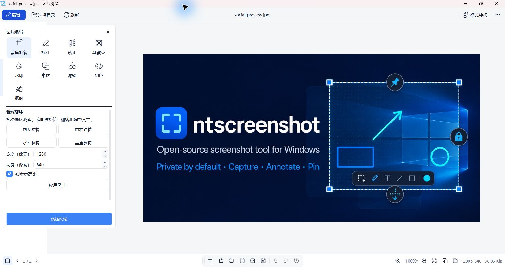

# 图片浏览与编辑

[English](image-browser.en.md)

## 格式转换

格式转换支持使用 Qt 导出单页 PDF，无需新增库。设置随目标格式切换：输出尺寸与锁定比例、彩色／灰度、JPEG/WebP 质量、PNG 无损压缩程度，以及 PDF 图片尺寸／A4 页面、自动／纵向／横向和页边距。PDF 导出会保留原图和撤销记录。

## 浏览与保存

托盘选择“图片浏览”，默认打开配置中的截图保存目录。小图按实际尺寸显示，大图自动适应留白区域；底部显示像素尺寸、文件大小、序号和缩放比例。支持选择或拖入目录、拖入图片定位、缩略图浏览、缩放和平移，以及裁剪、旋转、翻转、调整尺寸、撤销和重做。所有操作也可从右键菜单进入，F11 切换全屏、Esc 退出。`Ctrl+S` 默认另存为 PNG/JPEG，原图覆盖需单独确认；格式转换支持 PNG、JPEG、BMP，以及插件可用时的 WebP 和 ICO。ICO 提供 16／24／32／48／64／128／256 像素图标尺寸，等比缩放居中并补透明边，输出单尺寸图标。

托盘“图片浏览”使用固定全局快捷键 `Ctrl+Alt+I`，“设置”使用 `Ctrl+Alt+S`，注册成功后在菜单右侧显示。

## 编辑工具

点击左上角“编辑”打开左侧浮动面板，上方为九个工具按钮，下方直接显示所选工具的编辑详情，无需弹窗配置。提供裁剪旋转、标注、矫正、马赛克、水印、素材、滤镜、调色和抠图。标注选择矩形、椭圆或箭头后直接在图片上拖动，松开即完成；文字输入后点击图片放置，绘制过程中按 Esc 可取消。

马赛克选中工具后直接使用圆形画笔拖动涂抹，提供像素块、高斯模糊和纯色遮盖三个效果预览按钮，选中高亮，纯色预览跟随所选颜色，画笔直径以屏幕像素设置，不随图片尺寸和缩放比例变化，可调块大小或模糊半径及遮盖颜色，松开完成一笔，Esc 取消当前笔画，每笔可单独撤销。

水印支持四角、居中、平铺和自定义选区，透明度、字号、颜色和边距可调；素材可导入本地图片。裁剪、素材及自定义水印点击“选择区域”后在图片上拖动选区，按 Enter 或面板内“应用选区”确认，按 Esc 或“取消选区”取消；切换工具会取消未提交的选区。面板保持展开，图片自动避开面板区域；小窗口下详情区可滚动。

矫正通过输入原图四角坐标完成透视变换；滤镜提供黑白、复古、反色，以及 OpenCV 高斯模糊、中值降噪、锐化、边缘检测、自动二值化和自动对比度，调色支持亮度、对比度、饱和度、色温、色调和不透明度，提供渐变滑块、数值输入与一键重置，参数改变后自动生效；每 100 毫秒合并更新，连续调色共用一步撤销。图片处理不再反复刷新无关工具按钮的图标、样式和可用状态；处理期间请求的操作在最新结果完成后执行。

抠图采用 GrabCut：框选主体并在选区外保留背景，应用后背景变透明；支持细化次数与边缘羽化，保留原图尺寸和主体已有透明度，建议另存 PNG。分析图最长边限制为 1280 像素；复杂发丝和透明物体可能需要重新选区。编辑结果支持撤销、重做、复制和保存，使用现有 Qt/OpenCV，不需要新增依赖。

## 桌面与锁屏背景

Windows 下可从右上角“更多”菜单将当前图片设为桌面背景或锁屏背景，包含未保存的编辑结果。背景使用独立保存的图片副本，透明区域填充为白色，原图移动或删除不影响该副本；设置失败时显示系统错误。

## 动画与使用限制

GIF 可播放和暂停，通过“编辑当前帧”另存静态图片。动画 WebP 取决于已安装的 Qt 图片插件；不支持时会提示。仅浏览当前目录，超过 7200 万像素的图片使用受限预览。
